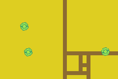

# Steel Ball Bouncers

Author: Corey Brown (forked from Auberon Lopez's repository).

Completion Date: 10/26/2026.

An exercise to learn about functions and classes. This program spawns up to 20 bouncers, balls that 'bounce' off the bounding walls fo the screen, spinning as they do so. Pressing A spawns a bouncer, pressing be with long the x-average of all of the bouncers currently on screen.